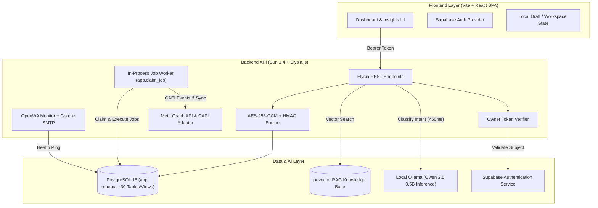

# FunnelLens — Funnel Intelligence Platform

> **"Pahami funnel-mu. Temukan titik bocornya. Pilih langkah berikutnya dengan percaya diri."**

**FunnelLens** adalah platform analitik dan intelijen funnel pemasaran (*Funnel Intelligence Platform*) modern yang dirancang khusus untuk pemilik bisnis (*business owner*), pemasar (*marketer*), dan tim *growth*. 

Platform ini menggabungkan kekuatan **React/Vite**, **Bun/Elysia**, **PostgreSQL (pgvector)**, dan **Supabase** untuk memetakan seluruh perjalanan calon pelanggan—mulai dari klik iklan pertama di Meta Ads, interaksi di Landing Page, percakapan di WhatsApp (OpenWA), hingga terjadinya transaksi penjualan riil (*verified purchase & closing*).

---

##  Mengapa FunnelLens Diciptakan? (Latar Belakang & Tujuan)

### Masalah yang Sering Dihadapi Bisnis
1. **Blind Spot Pemasaran**: Iklan jalan dan menghabiskan jutaan rupiah setiap hari, tetapi pemilik bisnis tidak tahu secara pasti di tahap mana calon pembeli berhenti atau kabur (*drop-off*).
2. **Data yang Terpecah (Data Silos)**:
   - **Meta Ads Manager** hanya melaporkan metrik semu (*vanity metrics*) seperti CTR, CPC, dan impresi.
   - **Landing Page Analytics** hanya mencatat jumlah kunjungan dan durasi baca.
   - **WhatsApp Sales/CS** penuh dengan ratusan chat tanpa ada klasifikasi mana prospek yang potensial atau sekadar tanya-tanya.
   - **Pembukuan Kas/Bank** mencatat omzet penjualan secara terpisah tanpa tahu iklan mana yang sebenarnya mendatangkan transferan tersebut.
3. **Keputusan Berdasarkan Tebakan**: Tanpa data terpadu, penyesuaian anggaran iklan dan pergantian materi kreatif sering kali hanya mengandalkan intuisi, bukan bukti nyata.

### Solusi & Nilai Utama FunnelLens
- **Melihat Funnel Secara Utuh**: Menyatukan semua titik data dari iklan, web, percakapan WhatsApp, hingga rekening kas menjadi satu garis lurus yang mudah dibaca.
- **Deteksi Titik Bocor Seketika**: Mengetahui secara presisi apakah kelemahan kampanye ada pada materi kreatif, daya tarik landing page, atau respons tim sales di WhatsApp.
- **AI yang Memahami Konteks Lokal**: Memanfaatkan model AI lokal (**Qwen 2.5 0.5B**) untuk membaca isi chat WhatsApp dan mengelompokkan minat pembeli secara otomatis tanpa mengorbankan privasi data.
- **Human-in-the-Loop Approval**: Rekomendasi perubahan strategi atau alokasi budget iklan memerlukan persetujuan pemilik bisnis (*owner confirmation*) sebelum diterapkan ke Meta Ads.
- **Keamanan Data Standar Perbankan**: Informasi kontak pelanggan (nama, nomor HP, chat) dienkripsi menggunakan AES-256-GCM + blind index HMAC sehingga aman dan patuh pada regulasi privasi (GDPR).

---

##  Fitur-Fitur FunnelLens & Apa yang Bisa Dilakukan

Berikut adalah rincian kemampuan FunnelLens yang terbagi ke dalam modul-modul intelijen utama:

### 1.  Overview (Executive Command Center)
Halaman ringkasan holistik bagi pengambil keputusan bisnis:
- **Metrik Utama Bisnis**: Memantau *Blended ROAS* (Return on Ad Spend sejati), *Customer Acquisition Cost* (CAC), total biaya iklan (*Total Spend*), pendapatan terverifikasi (*Verified Revenue*), dan estimasi laba bersih (*Net Margin*).
- **Snapshot Aliran Funnel**: Diagram batang interaktif yang memperlihatkan penurunan volume audiens dari tahap *Awareness* ➔ *Interest* ➔ *Consideration* ➔ *Purchase*.
- **Prioritas Tindakan Hari Ini**: Kartu rekomendasi cepat berisi langkah-langkah paling mendesak yang perlu ditinjau atau dieksekusi.

### 2.  Funnel Intelligence (Deteksi Titik Bocor & Kecepatan Alur)
Modul investigasi mendalam terhadap efisiensi perjalanan pelanggan:
- **Analisis Drop-off per Tahapan**: Mengukur persentase orang yang berhenti di setiap gerbang (misal: klik iklan ➔ buka landing page ➔ klik tombol WhatsApp ➔ chat aktif ➔ transfer pembayaran).
- **Conversion Velocity Tracker**: Mengetahui berapa lama rata-rata waktu yang dibutuhkan seorang calon pelanggan dari pertama kali melihat iklan hingga melakukan pembayaran.
- **Perbandingan Kanal Akuisisi**: Membandingkan efisiensi antara alur *Ads ke WhatsApp langsung* vs *Ads via Landing Page*.

### 3.  Audience Intelligence (Klasifikasi Intent AI & Kualitas Lead)
Mengubah kumpulan nomor WhatsApp dan kontak menjadi data perilaku yang berharga:
- **Klasifikasi Minat Otomatis via AI Lokal**: Model **Qwen 2.5 0.5B** menganalisis teks pesan masuk dan mengelompokkannya secara instan ke dalam 4 kategori:
  1. *Sangat Tertarik* (prospek panas siap transfer).
  2. *Tanya Harga & Spesifikasi* (tahap evaluasi produk).
  3. *Ragu-ragu / Keberatan* (butuh penanganan khusus atau FAQ).
  4. *Closing / Repeat Order* (pembeli terkonfirmasi).
- **Direktori Lead Aman & Terenkripsi**: Melihat daftar lead lengkap dengan riwayat timeline interaksi dari sentuhan pertama (*first touch*) tanpa menampilkan nomor telepon polos yang rentan bocor.
- **Evaluasi Kualitas Audiens Iklan**: Menilai audiens Meta Ads mana yang mendatangkan lead berkualitas tinggi, bukan sekadar klik murah tak bermutu.

### 4.  Campaign & Budget Intelligence (Manajemen Iklan & Safety Approval)
Pusat komando pengelolaan anggaran dan kampanye Meta Ads:
- **Penyusunan Draft Kampanye**: Merancang struktur kampanye, target audiens, dan batas anggaran harian dengan panduan batas wajar (*safety caps*).
- **Mekanisme Persetujuan Owner (*Approval Workflow*)**: Setiap tindakan perubahan skala budget atau aktivasi/penonaktifan iklan dibuat sebagai *Action Request*. Sistem tidak akan menyentuh API Meta sebelum pemilik bisnis menyetujuinya (*approve*).
- **Audit Log Terperinci**: Riwayat lengkap mengenai siapa yang mengusulkan perubahan, kapan disetujui, dan status eksekusinya oleh background worker.

### 5.  Creative Intelligence (Evaluasi Materi Iklan Berdasarkan Penjualan)
Menilai performa gambar, video, dan copy iklan bukan hanya dari *like*, melainkan dari *closing*:
- **Creative Performance Score**: Mengukur materi iklan mana yang paling efektif mendorong audiens melakukan interaksi mendalam dan transfer pembelian.
- **Deteksi Kejenuhan Iklan (*Creative Fatigue*)**: Memberi peringatan dini jika frekuensi tayang materi iklan terlalu tinggi dan tingkat konversinya mulai menurun, sehingga anggaran tidak terbuang sia-sia.
- **Korelasi Copy & Topik Chat**: Mengidentifikasi pesan dan *angle* penawaran iklan mana yang paling sering diungkit oleh pelanggan saat berbicara dengan tim sales di WhatsApp.

### 6.  AI Insight Center (Pusat Rekomendasi Cerdas)
Asisten analis bisnis cerdas yang bekerja 24/7:
- **Deteksi Anomali Otomatis**: Mendeteksi lonjakan biaya per lead, penurunan drastis rasio respons chat, atau anomali konversi secara otomatis.
- **Rekomendasi yang Dapat Ditindaklanjuti**: Menghasilkan saran strategis konkret (contoh: *"Naikkan budget Campaign A sebesar 20% karena rasio closing di WhatsApp mencapai 35%"* atau *"Perbaiki kecepatan respon CS pada rentang jam 19.00 - 21.00"*).
- **Estimasi Dampak & Tingkat Keyakinan**: Setiap insight disertai estimasi peningkatan omzet (*projected revenue lift*) dan tingkat keyakinan (*confidence score*).

### 7.  Strategy & Recalibration (Simulasi Skenario & RAG Knowledge)
Perencanaan jangka menengah dan adaptasi taktik pertumbuhan:
- **Simulasi Skenario Dinamis**: Menghitung estimasi hasil jika budget iklan dinaikkan 50%, jika harga jual produk diubah, atau jika alokasi difokuskan ke retensi pelanggan.
- **Knowledge Base RAG (pgvector)**: Mengunggah dokumen panduan produk (*playbook*), standar operasional prosedur (SOP) sales, atau data riset pasar yang dijadikan rujukan oleh model AI dalam merumuskan strategi bisnis.
- **Rekalibrasi Berkala**: Penyesuaian rekomendasi strategi otomatis setiap minggu/bulan berdasarkan data pencapaian riil.

### 8.  Business Impact (Rekonsiliasi Real Revenue & Laba Bersih)
Laporan finansial jujur tanpa manipulasi angka:
- **Verified Revenue Matching**: Menghubungkan transaksi transfer yang telah terverifikasi dengan data kontak dan sumber iklannya.
- **Perhitungan Metrik Finansial Riil**: Menghitung *Customer Lifetime Value* (LTV), *Contribution Margin*, serta rasio *LTV:CAC*.
- **Laporan Laba/Rugi Kampanye**: Memastikan pemilik bisnis mengetahui dengan pasti apakah strategi akuisisi yang dijalankan mendatangkan profit bersih di rekening bank.

### 9.  Onboarding & Business Profile Wizard
Langkah awal untuk memulai workspace bisnis:
- **Wizard Interaktif 6 Langkah**: Mengisi profil produk unggulan, harga jual, margin keuntungan, target market, dan persona pelanggan.
- **AI Brand Suggestions**: Membantu merumuskan nama brand, sudut pandang positioning, dan nada komunikasi (*tone of voice*) yang selaras dengan pasar target.
- **Sinkronisasi Draft Workspace**: Draft onboarding tersimpan otomatis dan disinkronkan ke PostgreSQL.

### 10.  Integrations & Data Privacy
Pengaturan koneksi eksternal dan perlindungan privasi:
- **Meta Ads OAuth**: Menghubungkan akun iklan, halaman Facebook, dan aset WhatsApp Business dengan otorisasi aman.
- **WhatsApp OpenWA Gateway**: Menghubungkan engine WhatsApp Web via Chromium dan memantau status sesi secara real-time.
- **Landing Page Tracker Snippet**: Script pelacak ringan yang dapat dipasang di web/landing page untuk mendeteksi event klik CTA ke WhatsApp.
- **Sistem Notifikasi Email (Google SMTP)**: Mengirimkan email darurat otomatis jika sesi WhatsApp terputus dari handphone.
- **GDPR Contact Erasure**: Tombol penghapusan data kontak sekali klik untuk menghapus dan menganonimkan data pribadi calon pelanggan secara permanen.

---

##  Arsitektur Sistem & Tech Stack

